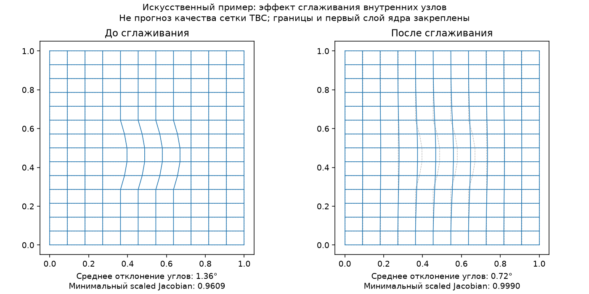

# Построение сетки, графики и контролируемое ядро

## Компоновка

Таблица «Параметры построенных блоков» перенесена с вкладки 2 на вкладку 3 рядом с графиками шагов по нормали. Выбор строки продолжает подсвечивать блок на сетке и обновлять график. Вкладка 2 отдана изображению сетки. Для большой сетки фактическое разрежение линий увеличивается автоматически; его значение указано в подсказке выбора детализации. Это только рисунок: узлы, экспорт и проверка качества не разрежаются.

В окне свойств переключатель переименован в «Расчёт теплопроводности λ (вязкость μ не меняется)»: базовая λ и λ с добавочным вкладом около критической точки. Он управляет только теплопроводностью и связанным Pr, не моделью mu. У вязкости есть своя формулировка и критический вклад; здесь используется промышленный вариант R12-08 в поддерживаемом регионе 1 (до 350 °C, вне критической области). Переключение lambda не должно менять mu, rho или y+.

## Новый строгий режим ядра

Выберите «Рост до размера → равномерное ядро (строго)» в группе заполнения ядра. Уже существующий адаптивный режим сохранён, но его название теперь явно указывает мягкие ограничения.

- **r**: первый шаг ядра / последний фактический шаг пристеночного слоя. При r=1 нет скачка на стыке; при r=1.2 первый шаг ядра на 20% больше последнего шага слоя.
- **q**: отношение последовательных шагов до выхода на плато. Например, первый шаг 12 мкм и q=1.1 дают 12, 13.2, 14.52… мкм до ограничения.
- **Максимальный допустимый шаг**: верхняя граница плато, не обещание одинакового размера во всех центрах.
- **Лимит слоёв**: ограничивает автоматически подбираемое общее N.

Для луча i используется `h[i,j] = min(r*h_wall[i]*q**j, plateau[i])`. Первое ядро сохраняет заданный переход, рост не превышает q, плато не превышает максимальный размер, сумма шагов равна оставшейся длине луча. Фактические последние шаги берутся из каждого построенного блока/луча, включая переопределения, а не только из первого блока. Пристеночные узлы не изменяются.

Структурированным сопрягаемым блокам нужно одинаковое число слоёв. Поэтому N подбирается общим, а plateau может различаться между лучами и быть меньше указанного максимума. Не любая комбинация ограничений возможна: короткий луч требует N*h_first <= L_min, длинный должен заполняться при тех же N, q и пределе размера. Если совместного решения нет, выдаётся ошибка с рекомендацией изменить r/q/максимальный размер/лимит N; скрытого увеличения q или размера нет. При q=1 точное равномерное заполнение возможно только при совместимых целых отношениях длина/первый шаг.

Строгий режим не гарантирует изотропию и пригодность для конкретной CFD-задачи. Проверяйте геометрическое качество и графики после заполнения. Старый адаптивный режим может менять фактический рост/размер для заполнения широких лучей; прежнее поведение сохранено для совместимости.

Подробный прогноз распределения большой сетки ограничен по объёму работы в GUI. Если он дорогой, появляется сообщение, что окончательные значения будут рассчитаны при построении. Это не изменяет параметры и не заменяет полный расчёт.

## Фоновое построение и прогресс

В интерактивном видимом окне построение слоя, сетки и заполнение ядра выполняются в QThread на снимках модели/переопределений. Проверка качества также идёт в рабочем потоке. Реальный QObject-контроллер доставляет сигналы в GUI-поток; все QWidget, графики и применение результата остаются в GUI.

Прогресс показывает этапы, подготовленные 3D-блоки и блоки проверки качества, прошедшее время. Это прогресс этапов, не оценка точного оставшегося времени. Отмена кооперативная: проверяется между этапами/блоками. Отдельный большой вызов NumPy/проверка блока не прерывается принудительно. Запрос закрытия окна сначала отменяет работу, дожидается её завершения и затем закрывает окно. Старое пригодное состояние не заменяется отменённым результатом.

При программном вызове скрытого окна сохранён синхронный контракт. Если входные параметры изменились за время фоновой работы, результат отбрасывается. Ошибка не открывает экспорт непостроенной/устаревшей сетки; существующие проверки актуальности остаются.

## Ускорение без изменения метрик

Проверка качества использует уже проверенную топологию построителя вместо повторного геометрического поиска всех пар 3D-граней. Для незаполненного слоя учитываются только действительно сопряжённые грани; неподсоединённые противоположные фронты не выдаются за интерфейсы.

Локальное измерение: 48 блоков, 14 784 ячейки, ni=12/nj=15/nz=2. Автопоиск + качество: 0.1741 с; явная топология + качество **включая экструдирование**: 0.1259 с. Это один измеренный пример, не гарантия такого же ускорения на любых сетках. Регрессионный тест сравнивает min/max/mean всех метрик и число интерфейсов с прежним обнаружением.

Полный объём 3D-данных всё ещё нужен для качества: фоновый поток не устраняет ограничения оперативной памяти. Прорисовка и заполнение таблицы выполняются в GUI, с разрежением графики для ограничения её стоимости.

## Проверки

Новые тесты проверяют ограничения ядра и неизменность слоя, равенство метрик после замены поиска стыков, перенос таблицы, отзывчивость событий Qt, GUI-поток применения результата, отмену, ошибку, закрытие во время работы, отбрасывание устаревшего результата и реальное интерактивное построение с восстановлением экспорта.

Исторический тест механического извлечения UI теперь сравнивает именно исходный коммит извлечения e2f362c; требование вечной неизменности текущего init_ui несовместимо с запрошенным переносом таблицы. Современная компоновка защищена отдельным поведенческим тестом.

## Экспериментальное сглаживание ядра: сравнение до/после

1. Постройте пристеночный слой и выберите режим заполнения ядра.
2. Включите «Сгладить ядро» и задайте число шагов (по умолчанию 15).
3. Заполните ядро. На вкладке сетки исходные линии показаны серым пунктиром, результат — цветом. Переключатель сравнения позволяет скрыть исходные линии.
4. На вкладке 3 выберите блок: график нормальных шагов также показывает исходный средний луч серым пунктиром. В сообщении результата приведены значения качества ядра до/после и число изменённых блоков.

Это первый этап: взвешенное эллиптическое сглаживание внутренних узлов существующих блоков. Все границы блоков, пристеночный слой и первый шаг ядра закреплены. Топология и число ячеек не меняются; это не совместная оптимизация стыков. Каждая пробная итерация принимается только при снижении среднего отклонения углов от 90° и сохранении минимального нормированного углового якобиана не хуже исходного. При неудаче шаг уменьшается; если приемлемого движения нет, сохраняются исходные координаты. В строгом режиме дополнительно проверяются фактические длины нормальных рёбер: предел размера, рост не выше q и отсутствие уменьшения шага.

Уже качественная сетка, закреплённые стыки или строгие ограничения могут дать ноль изменений. На небольшом примере подканала с фиксированным числом слоёв среднее отклонение углов изменилось с 5.0411° до 5.0286°, минимальный нормированный якобиан остался 0.8660. На том же примере строгий режим не принял ни одного движения. Алгоритм не обещает улучшения каждой метрики: обязательна обычная проверка полной 3D-сетки после построения.

Ниже искусственный пример с намеренно искривлёнными внутренними линиями, на котором эффект легче увидеть. Он не предсказывает величину улучшения для ТВС.

Функция по умолчанию выключена. Включение/изменение числа шагов инвалидирует полную сетку, сохраняя пригодный пристеночный слой; экспорт снова доступен после заполнения. Сравнение хранится в памяти вместе с текущим результатом и требует дополнительной памяти под исходную 2D-сетку. Флажок показа сравнения параметры сетки не изменяет.

На время фонового построения элементы основного окна отключены, диалог прогресса позволяет отмену. Это исключает повторный вход обработчиков при обновлении прогресса Qt.

Регрессионные проверки сглаживания охватывают неизменность слоя, первого шага и стыков, ограничения качества/размера, обратную ориентацию блоков, сравнение на графике и цикл построение → изменение → блокировка экспорта → повторное заполнение → разрешение экспорта.
